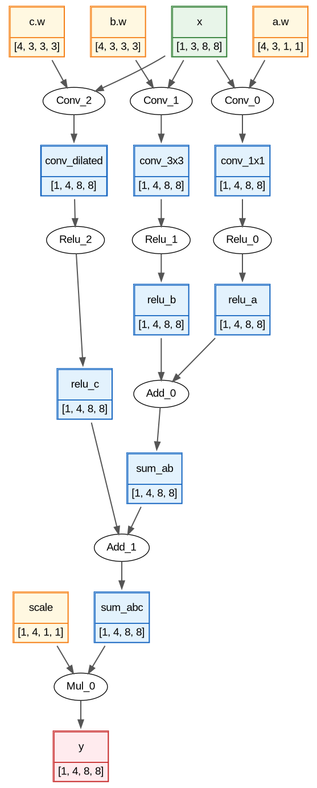

# Implementation of a Tensor Compiler

## About the project

A C++20 ahead-of-time compiler for statically shaped ONNX models. It imports an ONNX model into a computational graph, lowers it through MLIR and LLVM, and generates native code for the host CPU. On Linux, you can compile a model into a shared library once and run it with different inputs using the standalone runner.

## Part Ⅰ: Frontend

The frontend reads an ONNX model and builds a computational graph that connects each operation to its input and output tensors. The graph tracks which operation produces a tensor and which operations consume it. During import, the frontend reads the shapes of model inputs, outputs, and weights from ONNX and infers the shapes of intermediate tensors. It currently supports six operations: Add, Mul, Conv, Relu, MatMul, and Gemm. The graph can be exported to DOT and visualized with Graphviz.

## Part Ⅱ: MLIR and LLVM

The compiler translates the computational graph into MLIR and lowers it to LLVM IR. The driver lets you choose an optimization level from -O0 to -O3. It can emit lowered MLIR, LLVM IR, native assembly, and native object files.

## Part Ⅲ: Shared Libraries and Model Execution

On Linux, the compiler can link the generated object code into a shared library (.so). A standalone runner loads the compiled model at runtime and reads tensor shapes and types from the corresponding ONNX file. It reads input values from standard input and writes results to standard output. The same runner executable can load different compiled models. Once compiled, each model can be run with different inputs.

## Requirements

- CMake 3.28+
- C++20
- Protobuf (including protoc)
- LLVM and MLIR (tested with version 23)

### Optional

- Graphviz for rendering graphs
- Python 3.10+ with the numpy and onnx packages for generating test models and checking runner outputs

## Building the project

The build instructions below target Linux. On Windows, follow them in WSL.

Clone the repository and download the ONNX Protobuf schema.

```bash
git clone https://github.com/VoroninMatvey/Tensor-Compiler.git
cd Tensor-Compiler

mkdir -p third_party
curl -fL https://raw.githubusercontent.com/onnx/onnx/v1.17.0/onnx/onnx.proto \
  -o third_party/onnx.proto
```

Replace $HOME/tools/llvm-23 with the directory where you installed LLVM and MLIR.

```bash
cmake -S . -B build -DCMAKE_PREFIX_PATH="$HOME/tools/llvm-23"
cmake --build build --parallel
```

The build produces build/tensor_compiler and build/runner.

## Usage

Run the following commands from the repository root.

### Compiler

```text
./build/tensor_compiler <path/to/model.onnx> [options]
```

The compiler takes the path to an ONNX model as its positional argument.

```text
--emit=mlir  Emit lowered MLIR in the LLVM dialect.
--emit=llvm  Emit LLVM IR (default).
--emit=asm   Emit native assembly.
--emit=obj   Emit a native object file.
--emit=so    Emit a shared library on Linux.
-O0 to -O3   Select the optimization level (default: -O2).
-o <path>    Write output to the given path.
--draw-dot   Save the graph as a DOT file under data/dot_models/.
--help       Show the available options.
```

The output path is required for object files and shared libraries. Other formats default to standard output.

### Runner

```text
./build/runner <path/to/model.so> <path/to/model.onnx> [path/to/inputs.bin]
```

Pass the path to the shared library first and the path to the ONNX model used to compile it second. If the library is in the current directory, pass its path as ./model.so.

The runner reads input values from standard input. Supply the tensors in the order defined by the ONNX model and list each tensor’s values in row-major order. Use spaces or newlines to separate values. You can enter all values on a single line, even for models with multiple input tensors.

For each output tensor, the runner prints its name on one line and its flattened values on the next. The optional third argument specifies where to save the input values as a binary file for comparison with the ONNX reference implementation.

### Comparing outputs

The comparison script runs the original ONNX model with ReferenceEvaluator using the binary inputs saved by the runner. It compares the reference outputs with the runner’s text output.

```text
python3 tests/scripts/compare_runner_outputs.py <path/to/model.onnx> <path/to/inputs.bin> <path/to/outputs.txt>
```

Pass the ONNX model, the binary input file, and the file containing the runner’s standard output, in that order. The script requires the numpy and onnx Python packages.

## Tests

After building the project, run the shape inference and ONNX importer tests with CTest.

```bash
ctest --test-dir build --output-on-failure
```

To test the full pipeline, generate models, compile them, and compare the runner outputs with the ONNX reference implementation.

```bash
python3 tests/scripts/generate_stress_models.py --family all --count 4 --blocks 2 --seed 2026 --run
```

By default, each run saves its files in a new directory under temp/generated/.

Browse the [sample models, inputs, and comparison reports](examples/).

